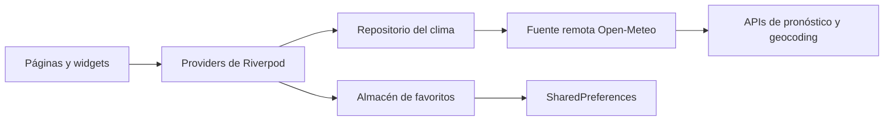

# Weatherly

<p align="center">
  <strong>El clima, sin ruido.</strong><br>
  Una app enfocada en consultar las condiciones actuales y pronósticos útiles para cualquier ciudad.
</p>

<p align="center">
  <a href="README.md">English</a> · <a href="README.es.md">Español</a>
</p>


Weatherly convierte los datos de Open-Meteo en un pronóstico claro y fácil de leer. Permite buscar ciudades, revisar las próximas 24 horas y siete días, y guardar lugares frecuentes como favoritos locales. La misma base de código se adapta desde teléfonos compactos hasta la web en pantalla ancha.

## Funcionalidades

- Temperatura actual y percibida, humedad, viento y condición meteorológica
- Pronóstico por hora para las próximas 24 horas y por día para siete días
- Búsqueda de ciudades con debounce, región y país
- Favoritos persistidos en el dispositivo con `SharedPreferences`
- Pull-to-refresh y reintentos claros cuando falla la red
- Navegación inferior en móvil y lateral en pantallas amplias
- Rutas de detalle que conservan el contexto de la ciudad
- Estados de carga, error y resultados vacíos diseñados explícitamente
- Proyectos para web, Android e iOS desde una sola base Flutter
- Tests unitarios, de providers, persistencia, repositorio y widgets sin depender de APIs reales

## Capturas

| Compacta | Amplia |
| --- | --- |
|  |  |

Las capturas provienen del build web ejecutándose; no son mockups.

## Inicio rápido

Necesitas Flutter `3.47.7` o una versión estable compatible.

```bash
git clone https://github.com/DevPooks/weatherly.git
cd weatherly
flutter pub get
flutter run -d chrome
```

No hace falta una API key ni un archivo de entorno. Weatherly utiliza los endpoints públicos de Open-Meteo.

## Arquitectura



La organización combina features con capas simples:

```text
lib/
├── core/                 # rutas, tema, red y estados compartidos
├── features/
│   ├── weather/
│   │   ├── data/         # modelos API, data source e implementación
│   │   ├── domain/       # entidades y contrato del repositorio
│   │   └── presentation/ # providers, páginas, widgets y códigos WMO
│   └── favorites/        # persistencia, provider, página y controles
├── app.dart
└── main.dart
```

Los widgets no procesan JSON ni hacen llamadas HTTP. El contrato del repositorio permite sustituir la red por fakes deterministas en los tests.

## Estado, navegación y datos

`flutter_riverpod` controla la ciudad seleccionada, el pronóstico, la búsqueda con debounce y los favoritos persistentes. `go_router` mantiene rutas para inicio, búsqueda, favoritos y detalle de ciudad. En móvil se usa navegación inferior y desde `960px` se presenta un rail lateral.

Los datos provienen de las APIs gratuitas de [geocoding](https://open-meteo.com/en/docs/geocoding-api) y [pronóstico](https://open-meteo.com/en/docs) de Open-Meteo. Las respuestas se convierten a entidades tipadas antes de llegar a la interfaz. Los códigos meteorológicos WMO se traducen a etiquetas e iconos legibles y cualquier código desconocido tiene un fallback seguro.

## Tests

La suite no utiliza servicios en vivo. Cubre el mapeo de payloads, códigos WMO, providers, debounce, favoritos, estados del pronóstico, búsqueda y estados vacíos.

```bash
dart format --output=none --set-exit-if-changed .
flutter analyze
flutter test
flutter build web --release
```

## Decisiones y límites

- La primera versión usa una ciudad por defecto y búsqueda explícita; no solicita ubicación.
- Los favoritos se guardan localmente, pero los pronósticos requieren red y no se presentan como disponibles offline.
- Solo se muestran unidades métricas.
- Los favoritos no se sincronizan entre dispositivos.
- Alertas, mapas, actualización en segundo plano y caché offline quedan fuera del alcance actual.

Las decisiones visuales y responsive están documentadas en [DESIGN.md](DESIGN.md). También puedes consultar las [notas de arquitectura](docs/architecture.md), las [notas para entrevistas](docs/interview-notes.md) y el [resumen para CV](docs/cv-summary.md).

## Licencia

Publicado bajo la [Licencia MIT](LICENSE).
