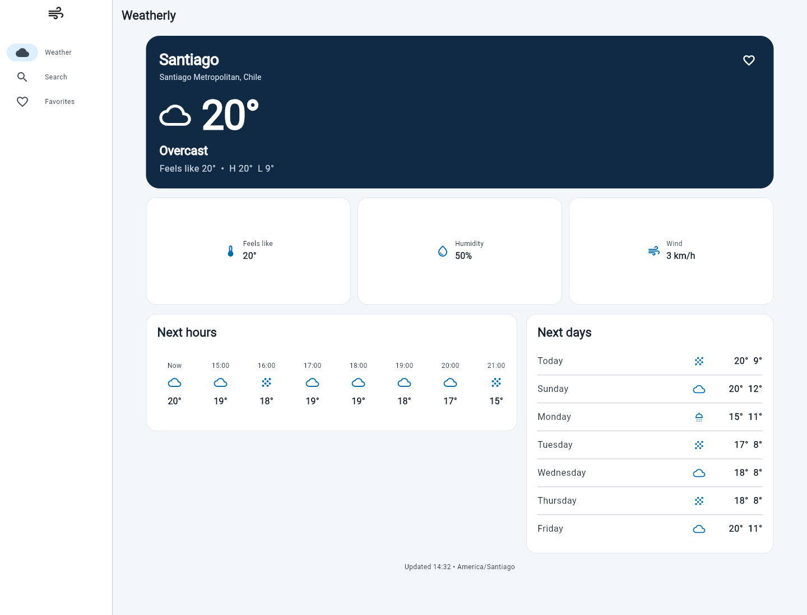
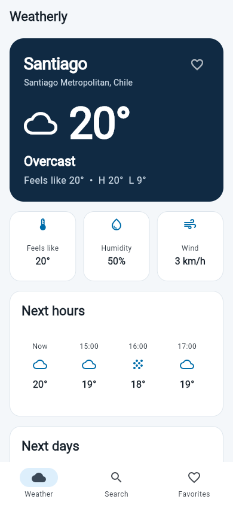
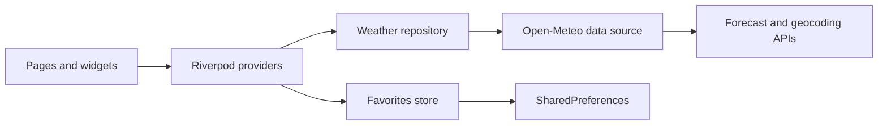

# Weatherly

<p align="center">
  <strong>Weather, without the noise.</strong><br>
  A focused Flutter app for checking current conditions and practical forecasts in any city.
</p>

<p align="center">
  <a href="README.md">English</a> · <a href="README.es.md">Español</a>
</p>

<p align="center">
  
  
  <a href="https://github.com/DevPooks/weatherly/actions/workflows/ci.yml"></a>
  <a href="LICENSE"></a>
</p>



Weatherly turns Open-Meteo data into a calm, readable forecast. Search for a city, inspect the next 24 hours and seven days, and keep frequently checked places available as local favorites. The same codebase adapts from compact phones to wide web layouts.

## Why this project exists

Weather apps are a useful engineering exercise because the interface looks simple while the data is not: network requests fail, city names collide, weather codes need translation, forecasts use parallel arrays, and layouts have to stay legible at very different sizes.

Weatherly keeps those concerns explicit. API payloads are parsed in the data layer, domain objects remain typed, Riverpod owns asynchronous state, and the UI handles loading, empty, success, and failure paths deliberately.

## Features

- Current temperature, apparent temperature, humidity, wind, and condition
- The next 24 hourly readings and a seven-day forecast
- Debounced city search with region and country context
- Favorites persisted on-device with `SharedPreferences`
- Pull-to-refresh and clear retry paths for network failures
- Responsive bottom navigation and navigation rail layouts
- Route-backed city detail pages that remain meaningful when deep-linked
- Accessible semantics, readable contrast, and touch-friendly controls
- Web, Android, and iOS project targets from one Flutter codebase
- Unit, provider, persistence, repository, and widget tests without live API calls

## Screenshots

| Compact | Wide |
| --- | --- |
|  |  |

These screenshots are generated from the running web build rather than mockups.

## Quick start

### Requirements

- Flutter `3.47.7` or a compatible stable release
- Dart `3.13.5` or later within the supported SDK range
- Chrome for web development, or an Android/iOS toolchain for device builds

```bash
git clone https://github.com/DevPooks/weatherly.git
cd weatherly
flutter pub get
flutter run -d chrome
```

No API key or environment file is required. Weatherly uses the public Open-Meteo endpoints.

## Architecture



The project uses lightweight feature-first boundaries:

```text
lib/
├── core/                 # routing, theme, networking, shared states
├── features/
│   ├── weather/
│   │   ├── data/         # API models, data source, repository implementation
│   │   ├── domain/       # entities and repository contract
│   │   └── presentation/ # providers, pages, widgets, WMO mapping
│   └── favorites/        # local store, provider, page, controls
├── app.dart
└── main.dart
```

The repository boundary makes HTTP behavior replaceable in tests. Pages never parse JSON or call the network directly, and the favorites store can be substituted with an in-memory implementation.

## Tech stack

| Technology | Role |
| --- | --- |
| Flutter + Dart | Cross-platform widgets and application logic |
| Riverpod | Dependency injection and asynchronous state |
| Dio | REST requests, parameters, timeouts, and transport errors |
| go_router | Declarative, URL-aware navigation |
| SharedPreferences | Small local favorites store |
| flutter_test | Unit, provider, and widget verification |
| Open-Meteo | Geocoding and forecast data |

## State and navigation

`flutter_riverpod` manages selected-city state, forecast requests, debounced search, and persisted favorites. Forecast and search providers are `autoDispose`, keeping transient results scoped to the active screen.

`go_router` provides four routes:

- `/` — current selected city
- `/search` — city search
- `/favorites` — saved cities
- `/city/:id` — a shareable detail route with city metadata in the query string

On phones, destinations appear in a bottom navigation bar. At `960px` and above, the shell moves them to a navigation rail without changing the route model.

## Weather data

Weatherly uses two free Open-Meteo services:

- [Geocoding API](https://open-meteo.com/en/docs/geocoding-api) for city matches
- [Forecast API](https://open-meteo.com/en/docs) for current, hourly, and daily conditions

Requests use automatic local time zones, metric units, explicit timeouts, and typed mapping. WMO weather codes are translated into user-facing labels and icons inside the presentation layer. Unknown codes fall back safely instead of exposing a raw number.

## Error and empty states

- Short searches show guidance without sending a request.
- No-result searches offer a useful next step.
- Timeouts and connection errors become plain-language messages.
- Failed weather and search requests include retry controls.
- Corrupt local favorite data falls back to an empty list.

Weather data is never presented as fresh when a request failed; this version does not implement an offline forecast cache.

## Testing

The suite avoids live network dependencies. Fake repositories and local stores cover:

- geocoding and forecast payload mapping
- WMO condition mapping and unknown-code fallback
- provider state and debounced search behavior
- favorite loading, toggling, removal, and persistence
- summary rendering and weather loading/error states
- search prompt, loading, results, and empty states

Run the same checks used by CI:

```bash
dart format --output=none --set-exit-if-changed .
flutter analyze
flutter test
flutter build web --release
```

## Design decisions

- **No location permission in v1.** A predictable default city and explicit search keep setup simple and testable.
- **No API key.** Open-Meteo makes the project easy to run locally and safe to fork.
- **No offline forecast cache.** Favorites persist, but weather remains clearly network-backed so stale data is not mistaken for current data.
- **Typed mapping at the boundary.** Parallel API arrays are validated before they reach widgets.
- **Practical layering.** Features have clear seams without adding code-generation or a large abstraction framework.

The visual rules and responsive decisions are documented in [DESIGN.md](DESIGN.md).

## Limitations

- Temperatures and wind are currently shown only in metric units.
- Forecasts depend on Open-Meteo availability and network access.
- City details are encoded in the route for reproducible navigation; the app does not maintain a separate city database.
- Favorites are local to one browser or device and do not sync between installations.
- Device location, severe-weather alerts, maps, and background refresh are outside the current scope.

## Roadmap

- User-selectable measurement units
- Optional device-location flow with a clear permission explanation
- Cached last-known forecast with visible freshness metadata
- Localization beyond English
- Golden tests for key responsive breakpoints

## Documentation

- [Design system](DESIGN.md)
- [Architecture notes](docs/architecture.md)
- [Interview notes](docs/interview-notes.md)
- [CV summary](docs/cv-summary.md)
- [Contributing guide](CONTRIBUTING.md)

## License

Released under the [MIT License](LICENSE).
