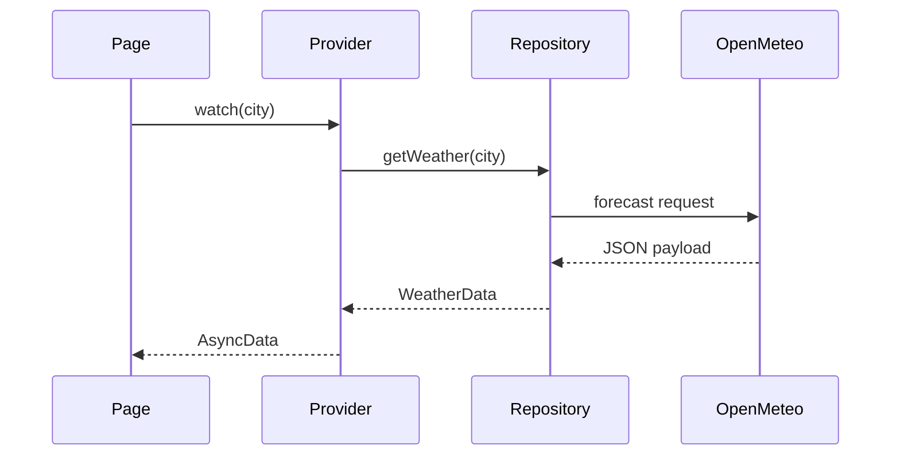

# Architecture

Weatherly is organized around two features—weather and favorites—with a small shared core. The goal is to keep each boundary visible without turning a compact application into a framework.

## Request flow

1. A page watches a Riverpod provider for the selected city or search query.
2. The provider calls the `WeatherRepository` contract.
3. `OpenMeteoWeatherRepository` delegates HTTP work to `WeatherRemoteDataSource`.
4. API models validate and convert the response into domain entities.
5. Widgets render only typed entities and an `AsyncValue` state.

## Boundaries

### Domain

`City`, `WeatherData`, `CurrentWeather`, `HourlyForecast`, and `DailyForecast` describe the information the app needs. They are independent from Dio, JSON, and Flutter widgets. `WeatherRepository` is the contract consumed by the presentation layer.

### Data

The Open-Meteo data source owns endpoints and query parameters. Models handle external field names and parallel-array validation. The repository maps transport failures to `WeatherException` messages appropriate for the interface.

### Presentation

Riverpod providers coordinate asynchronous work and state. `go_router` owns navigation. Pages compose reusable widgets, while the condition mapper converts WMO codes to labels and Material icons.

### Persistence

Favorites are serialized as a small JSON list through a `FavoritesStore` contract backed by `SharedPreferences`. Invalid local data is treated as an empty list rather than crashing startup.

## Responsive strategy

The application uses layout constraints rather than device names:

- Below `760px`, forecast cards stack vertically.
- From `760px`, hourly and daily forecasts share a row.
- From `960px`, bottom navigation becomes a navigation rail.
- Main content stops growing at `1120px` to preserve readable line lengths and information density.

## Testability

External dependencies are injected through providers and interfaces. Tests replace the repository and favorites store with in-memory fakes, so the suite is deterministic and never needs Open-Meteo or platform storage. Repository tests use a fake data source to test mapping independently from HTTP.

## Tradeoffs

- The route includes city metadata so a detail URL can reconstruct state without a city database. This makes URLs longer but preserves direct navigation.
- Forecast responses are not cached. The interface can therefore distinguish a successful live response from a network failure, at the cost of no offline forecast.
- A fixed 350ms debounce keeps search simple. Cancellation prevents old providers from remaining in the UI, although an already-started repository request may still finish in the background.
